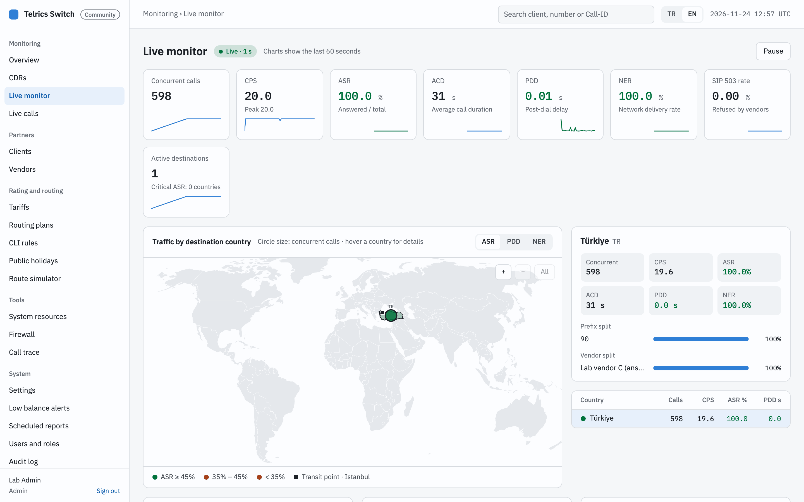
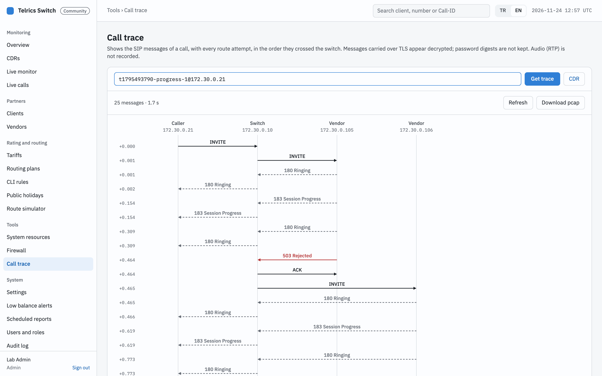
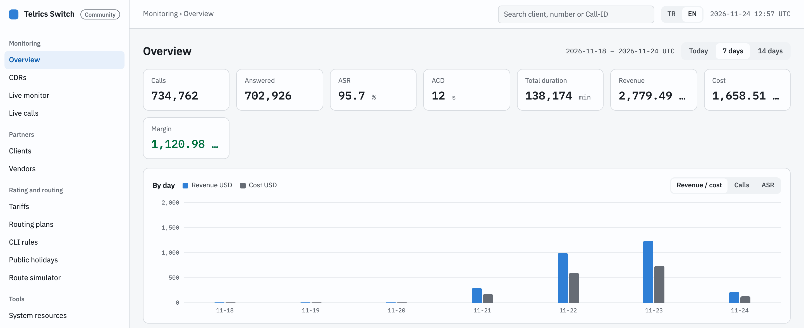
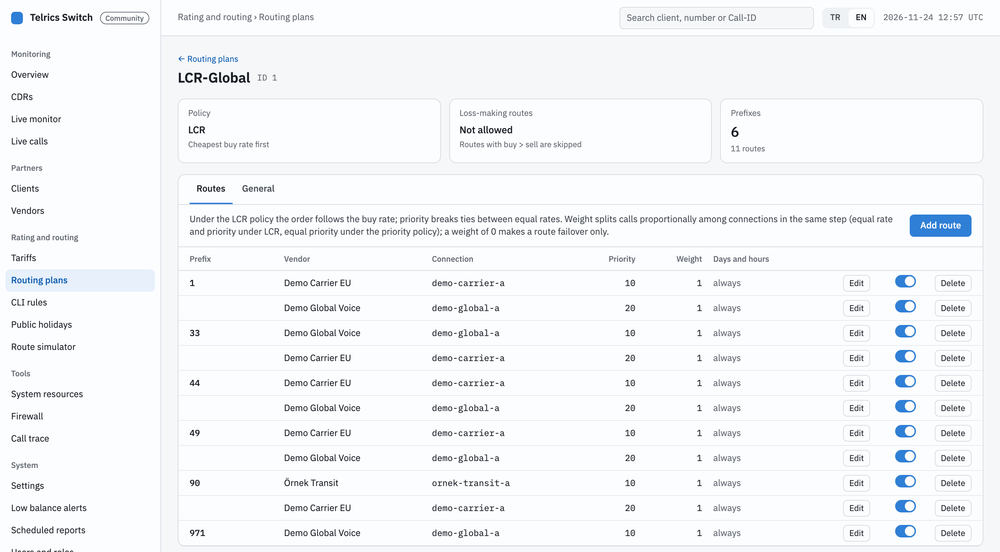
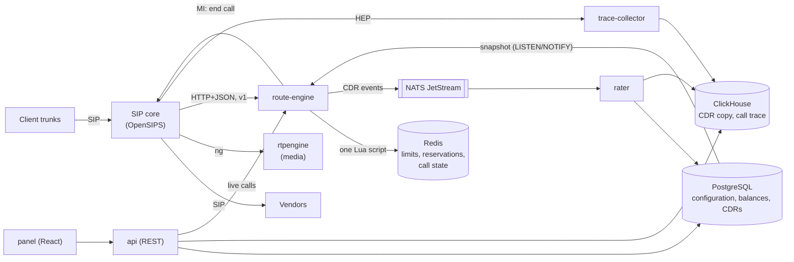

# Telrics Switch — Community

**English** · [Türkçe](README.tr.md)

[](https://github.com/peritotr/telrics-switch/actions/workflows/ci.yml)

A **Class 4 SIP softswitch** for carriers that move wholesale voice traffic: routing, rating and billing, a management API and an admin panel in one product. [OpenSIPS](https://opensips.org/) carries the SIP signalling and [rtpengine](https://github.com/sipwise/rtpengine) the media; all business logic lives in Go services that talk to them over the network only.

This repository is the open-source **Community** edition ([AGPL-3.0-only](LICENSE)): a complete product that runs on one server with one account. The admin panel is available in English and Turkish. The user-facing documentation is in English in [`docs/en/`](docs/en/); development documents (roadmap, tasks, decision records, SIP core interface details) are in Turkish.


<sub>Live monitor with lab traffic</sub>

## Status

- **Done:** lab and load-test rig (phase 0), routing core (phase 1), rating, limits and balance reservation (phase 2), management API and panel (phase 3); TLS/SRTP, registration (REGISTER) and NAT traversal, IPv6, transcoding, call trace, monitoring and a single-server install. Details: [`docs/03-yol-haritasi.md`](docs/03-yol-haritasi.md) (Turkish); status feature by feature: [`docs/en/05-feature-catalogue.md`](docs/en/05-feature-catalogue.md).
- **Measured in the lab only:** every result so far comes from a developer machine (macOS, Docker). Load testing on a Linux server, kernel-mode media forwarding and high availability have not been done yet (phase 4).
- **The production layout is new:** the single-server install is tested end to end on a private Docker network (`make prod-smoke`), but the host-network layout that production uses for the call path (`docker-compose.host.yml`) is only now being run on a real server for the first time. Certificates from a public CA, a real NAT router and IPv6 on a real server are also still to be tried. Read "Known limits" in [`docs/en/09-installation.md`](docs/en/09-installation.md#known-limits) before going to production.
- **Not yet available:** SSO, number portability (MNP/LRN) lookups, STIR/SHAKEN, a ready-made Grafana dashboard. Open work: [`docs/TASKS.md`](docs/TASKS.md) (Turkish).

## Features

Each item is marked "available" in [`docs/en/05-feature-catalogue.md`](docs/en/05-feature-catalogue.md) and covered by tests; limits are written down in the relevant document.

**Routing**
- Longest-prefix match; LCR (cheapest first) and priority ordering; loss protection (a route whose buy rate exceeds the sell rate is skipped).
- Weighted (percentage) distribution between routes of the same step; failover to the next route by SIP response code (configurable per connection).
- Routes and rates by day of week and time of day, time zones, public-holiday calendar.
- Number manipulation per vendor connection and per client trunk; caller ID (CLI) rules: block / allow / rewrite / anonymise, `P-Asserted-Identity` and `Privacy` support.
- Route simulation (`POST /v1/route/simulate`).

**Rating and balance**
- Sell and buy tariffs: initial and increment billing, connection fee, free seconds, versions with effective dates, CSV upload; tariffs with millions of rates (the engine re-reads only the prefixes that changed).
- Real-time balance reservation: a call reserves money in 60-second steps and the engine hangs it up before the money runs out, so balances are never overdrawn.
- Bundled minutes, multiple currencies with exchange rates (optionally from the European Central Bank), low-balance warnings and e-mails.
- Money is an integer everywhere (`int64`, millionths of a unit); no floating point.

**SIP and media** ([`docs/08-cagri-arayuzu.md`](docs/08-cagri-arayuzu.md), Turkish)
- Client trunks are identified by address (several addresses and networks, IPv4 and IPv6, tech prefix) or by username and password (Digest); registration (REGISTER) and endpoints behind NAT.
- Concurrent-call and CPS limits per client, trunk and vendor connection (in Redis, in one atomic script).
- Topology hiding; TLS signalling and SRTP media; vendor certificate name checks; Digest authentication and registration towards vendors; vendor health checks (SIP OPTIONS).
- Re-INVITE, offerless INVITE, early media and PRACK, T.38 and SIP INFO pass through; calls whose media stops are torn down; transcoding on a single server (off by default).

**Call records, reports and monitoring** ([`docs/en/10-monitoring.md`](docs/en/10-monitoring.md))
- Every attempt is its own CDR leg; records travel through NATS JetStream at least once and wait in the engine's on-disk journal while NATS is down. PostgreSQL is the system of record, ClickHouse a copy.
- ASR, ACD, PDD, NER, revenue, cost and margin reports; CSV export; scheduled report e-mails; live monitor and live calls (with hang-up).
- Call trace: SIP signalling is copied over HEP to the install's own collector and stored in ClickHouse; the panel draws the ladder diagram and downloads pcap (signalling only; audio is never recorded).
- Prometheus metrics and alert rules (Alertmanager), application-level firewall, system resources in the panel.

**Management** ([`docs/en/06-api.md`](docs/en/06-api.md), [`docs/07-panel.md`](docs/07-panel.md) (Turkish))
- REST API; its description is generated by the running server (`GET /v1/openapi.json`, OpenAPI 3.0).
- Admin panel in English and Turkish (React + TypeScript + Vite).
- API keys and panel users, two roles (admin, read-only), two-step sign-in (TOTP), an audit log of every change.

## Screenshots

Taken in the lab with fictional demo data and real calls generated by SIPp.

<table>
<tr>
<td width="50%"><a href="docs/images/en/call-trace.png"></a><br><b>Call trace</b>: every SIP message of one call; the first vendor answers 503 and the call fails over to the next one. Downloadable as pcap.</td>
<td width="50%"><a href="docs/images/en/overview.png"></a><br><b>Overview</b>: calls, ASR, ACD, revenue, cost and margin, with a daily chart and breakdowns by client, vendor and prefix.</td>
</tr>
<tr>
<td width="50%"><a href="docs/images/en/routing-plan.png"></a><br><b>Routing plan</b>: vendor connections per prefix; LCR or priority, weights, day and time windows, loss protection.</td>
<td width="50%"><a href="docs/images/en/live-monitor.png"></a><br><b>Live monitor</b>: counters for the last 60 seconds, refreshed every second; breakdown by country, prefix and vendor.</td>
</tr>
</table>

## Architecture



- **OpenSIPS** only carries SIP; its script is kept thin and makes no decisions. It asks `route-engine` about every call through a versioned HTTP interface that is independent of the SIP server ([ADR-0002](docs/decisions/0002-is-mantigi-motorda-surumlu-arayuz.md), Turkish). **rtpengine** relays the media of every call.
- **route-engine** decides from an immutable in-memory snapshot of the configuration: there is no SQL on the call path, and each call runs a single Redis script ([ADR-0003](docs/decisions/0003-cagri-yolunda-sql-yok.md), Turkish). The snapshot is refreshed immediately through `NOTIFY` whenever the API writes.
- **rater** takes call records from NATS JetStream, rates them, charges balances, writes them to PostgreSQL and copies them to ClickHouse; a record delivered twice is processed once.
- **api** serves the management API and the panel; reports are read from ClickHouse (PostgreSQL when it isn't configured).
- More: [`docs/en/ARCHITECTURE.md`](docs/en/ARCHITECTURE.md) (components, interfaces, call flows, concurrency, error and timeout strategy) and the decision records in [`docs/decisions/`](docs/decisions/README.md) (Turkish).

## Capacity: target and measured

| | |
|---|---|
| Target | 20,000 concurrent calls, 1,000 CPS sustained; call decision p99 < 10 ms. This is a **target**; the part beyond one server will come from clustering (Enterprise) and be verified on real servers. Capacity plan: [`docs/en/02-capacity-plan.md`](docs/en/02-capacity-plan.md) |
| Measured (developer machine, macOS + Docker) | `make load CPS=200 CC=2000 DURATION=30`: 6,000 calls, 0 failures; call decision p50 0.2–0.3 ms, p99 0.6–4.6 ms depending on machine load (recent runs). In-memory decision ~1.5 µs (`go test -bench Authorize ./pkg/routing`). Snapshot refresh of a 5-million-rate tariff with nothing changed ~10 ms |
| Limits of the measurement | The default load test sends no audio (signalling and relay sessions; `TRANSCODE=1` mode does stream audio). With other work on the machine, decision p99 can exceed the budget. Nothing has been measured on a Linux server or with kernel-mode media forwarding yet |

## Quick start (lab)

Requirements: Docker with Compose, Go (the version in `go.mod`), Node.js and npm (for the panel), `make`, `openssl`, `curl`, Python 3 (demo data and the e-mail test). The OpenSIPS image is built from source, so the first start takes a few minutes.

```sh
make lab-up          # OpenSIPS, rtpengine, PostgreSQL, Redis, ClickHouse, NATS, SIPp, route-engine, rater, trace-collector
make test-call       # loads the lab data (make lab-seed) and places one call
make load CPS=50 CC=1000   # load test; report and PASS/FAIL
make lab-down
```

Management API and panel:

```sh
set -a; . test/seed/dev.env; set +a  # lab API key and panel user
make api-run                         # API on 127.0.0.1:58080 (keep it running in a separate terminal)
make seed-user                       # lab panel user
make seed                            # demo data for the panel
make panel-install && make panel-dev # panel on 127.0.0.1:58081 (add ?lang=en or use the TR/EN switch)
```

Lab ports are in the 56xxx/58xxx range so they don't clash with other projects (PostgreSQL 56432, Redis 56379, ClickHouse 58123, mail catcher 58025, route-engine 58090). The values in `deploy/compose/lab.env` and `test/seed/dev.env` are **for the lab only**; never use them in an installation. A production install generates its own secrets.

## Production install

Installs on a single Linux server with Docker Compose (`deploy/prod/`): `install.sh` generates the secrets, builds the images on the server and starts the services; `upgrade.sh`, `backup.sh` and `restore.sh` handle upgrades, backups and restores. Releases are tagged `vMAJOR.MINOR.PATCH` and published as [GitHub Releases](https://github.com/peritotr/telrics-switch/releases) with notes from [`CHANGELOG.md`](CHANGELOG.md); `./deploy/prod/upgrade.sh <tag>` fetches a release, takes a backup and moves to it. Optionally the panel is served over HTTPS by Caddy, the SIP certificate is obtained automatically and monitoring (Prometheus, Alertmanager) is added. Steps, settings, network-level protection (sample nftables rules) and known limits: [`docs/en/09-installation.md`](docs/en/09-installation.md). The note under "Status" above applies.

## Tests

| Command | Covers |
|---|---|
| `make test` | Unit tests; no lab needed |
| `make ci` | What CI runs on every push and pull request (no lab): gofmt, vet, build, unit tests; panel type check, catalogues, build |
| `make test-engine` | route-engine against the lab Redis |
| `make test-api` | API end to end, on a separate database in the lab PostgreSQL |
| `make test-openapi` | Redocly lint of the API description |
| `make test-routing` | SIPp scenarios with real calls: failover, rejection, limits, reservation, CANCEL, re-INVITE, TLS/SRTP, NAT, IPv6, transcoding, call trace… |
| `make test-journal` | No call record is lost when the engine dies while NATS is down |
| `make test-reports`, `make test-archive`, `make test-mail` | ClickHouse and PostgreSQL reports agree, archiving, e-mail |
| `make load CPS=<n> CC=<n>` | Load test; PASS/FAIL including the decision-time p99 budget |
| `make prod-smoke` | Single-server install end to end: install, a call, a crash, backup and restore, upgrade |

Full command list and contribution rules: [`CONTRIBUTING.md`](CONTRIBUTING.md), [`Makefile`](Makefile).

## Repository layout

```
cmd/             Go entry points: api, route-engine, rater, trace-collector
pkg/             Go packages (not internal/, because the Enterprise edition imports them)
sip/opensips/    OpenSIPS configuration (template)
media/rtpengine/ rtpengine configuration (template)
db/migrations/   PostgreSQL and ClickHouse schema
web/             Admin panel (React + TypeScript + Vite)
deploy/          Lab (compose), images, single-server install (prod)
test/            SIPp scenarios, load test, demo data
docs/            Documentation (docs/en/ in English; development documents in Turkish)
```

## Documentation

| Document | Topic |
|---|---|
| [`docs/en/ARCHITECTURE.md`](docs/en/ARCHITECTURE.md) | Components, interfaces, call flows, concurrency, error strategy, open questions |
| [`docs/en/02-capacity-plan.md`](docs/en/02-capacity-plan.md) | Capacity plan |
| [`docs/en/04-open-core.md`](docs/en/04-open-core.md) | Community and Enterprise |
| [`docs/en/05-feature-catalogue.md`](docs/en/05-feature-catalogue.md) | Feature catalogue and status |
| [`docs/en/06-api.md`](docs/en/06-api.md) | Management API |
| [`docs/en/09-installation.md`](docs/en/09-installation.md) | Single-server install, upgrades, backups |
| [`docs/en/10-monitoring.md`](docs/en/10-monitoring.md) | Metrics, alerts, call trace |
| [`docs/decisions/`](docs/decisions/README.md) (Turkish) | Architecture decision records (ADR) |
| [`docs/03-yol-haritasi.md`](docs/03-yol-haritasi.md) (Turkish) | Roadmap and what has been done |
| [`docs/07-panel.md`](docs/07-panel.md) (Turkish) | Admin panel |
| [`docs/08-cagri-arayuzu.md`](docs/08-cagri-arayuzu.md) (Turkish) | Interface between the SIP core and the engine |
| [`docs/TASKS.md`](docs/TASKS.md) (Turkish) | Open work |

The Turkish documents are the source; each English document names its Turkish original at the top.

## Community and Enterprise

The product follows an open-core model; the editions differ by capability, not by limits on numbers ([`docs/en/04-open-core.md`](docs/en/04-open-core.md)).

- **Community** (this repository): single node, single account; includes routing, rating, limits, CDRs, reports, call trace, monitoring, the API, the panel and the single-server install.
- **Enterprise:** a separate, commercially licensed edition that adds capabilities such as multiple nodes and high availability, reseller hierarchy, invoicing, DIDs, quality-based routing and fraud detection. It uses this repository as a Go module and plugs into its extension points; this repository contains no Enterprise code and never imports it.

## Licence and contributing

[GNU Affero General Public License v3.0](LICENSE) (`AGPL-3.0-only`); the copyright notice is in [`NOTICE`](NOTICE). Every source file carries an `SPDX-License-Identifier: AGPL-3.0-only` header.

OpenSIPS (GPLv2) and rtpengine (GPLv3) are separate processes; the code here talks to them over the network only, contains none of their code and does not link to them ([ADR-0009](docs/decisions/0009-gpl-bilesenlerle-yalnizca-ag.md), Turkish).

Contributions are welcome, but because the same code is also the basis of the Enterprise edition, a **contributor licence agreement (CLA)** must be signed before anything is merged. The CLA text will be published separately; until then pull requests can be discussed but not merged. Details: [`CONTRIBUTING.md`](CONTRIBUTING.md).

## Security

Please report vulnerabilities privately, not as public issues, as described in [`SECURITY.md`](SECURITY.md). Components such as the SIP core's management socket, Redis and NATS have no authentication and rely on a private network; see [`docs/en/09-installation.md`](docs/en/09-installation.md).
