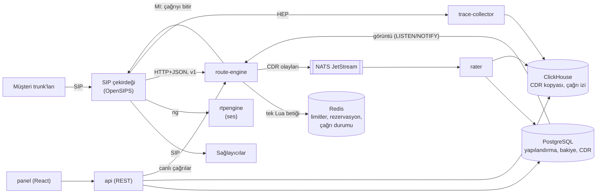

# Telrics Switch — Community

Toptan (wholesale) ses trafiği taşıyan operatörler için **Class 4 SIP anahtarlama platformu (softswitch)**: yönlendirme, ücretlendirme ve faturalama, yönetim API'si ve yönetim paneli tek üründe. SIP sinyalleşmesini [OpenSIPS](https://opensips.org/), sesi [rtpengine](https://github.com/sipwise/rtpengine) taşır; bütün iş mantığı onlarla yalnızca ağ üzerinden konuşan Go servislerindedir.

Bu depo ürünün açık kaynak **Community** sürümüdür ([AGPL-3.0-only](LICENSE)): tek sunucuda, tek hesapla çalışan, tek başına kullanılabilir bir üründür. Belgeler Türkçedir ([`docs/`](docs/)).

## In English

Telrics Switch Community is an open-source Class 4 SIP softswitch for wholesale voice carriers. It does prefix and least-cost routing with weighted distribution and failover, real-time prepaid/postpaid rating with balance reservation, per-customer, per-trunk and per-vendor call and CPS limits, call detail records that are never lost, reports, a REST API described by OpenAPI, and a React admin panel. OpenSIPS carries the SIP signalling and rtpengine the media; all business logic lives in Go services (`route-engine`, `rater`, `api`, `trace-collector`) that talk to them over the network only, through a versioned interface. Configuration and balances are in PostgreSQL, counters and reservations in Redis, call records go through NATS JetStream and are copied to ClickHouse.

**Status:** the single-node product is feature-complete for its first release and covered by unit, API and SIPp call tests, but all measurements so far come from a developer laptop (Docker on macOS). Load testing on a Linux server, kernel-mode media forwarding and high availability have not been done; the production install's host-network mode has not yet been run on a real server. The capacity target (20,000 concurrent calls, 1,000 CPS) is a target, not a measured result. Clustering and multi-tenant features belong to a separate commercial Enterprise edition built on top of this repository. Contributions require a signed CLA (`CONTRIBUTING.md`); report vulnerabilities privately (`SECURITY.md`). Documentation is in Turkish.

## Durum

- **Tamamlanan:** laboratuvar ve yük testi düzeneği (Faz 0), yönlendirme çekirdeği (Faz 1), ücretlendirme, limitler ve bakiye rezervasyonu (Faz 2), yönetim API'si ve panel (Faz 3); TLS/SRTP, kayıt (REGISTER) ve adres çevirisi (NAT), IPv6, kodek çevirisi, çağrı izi, izleme ve tek sunucu kurulumu. Ayrıntı: [`docs/03-yol-haritasi.md`](docs/03-yol-haritasi.md); özellik özellik durum: [`docs/05-ozellik-katalogu.md`](docs/05-ozellik-katalogu.md).
- **Ölçümler yalnızca laboratuvarda:** bütün sonuçlar bir geliştirici makinesinde (macOS, Docker) alındı. Gerçek Linux sunucuda yük testi, çekirdek (kernel) içi ses aktarımı ve yüksek erişilebilirlik henüz yapılmadı (Faz 4).
- **Üretim kurulumu denenmemiş bir yerleşim içerir:** tek sunucu kurulumu özel bir Docker ağında uçtan uca sınanıyor (`make prod-smoke`), ama üretimde çağrı yolunun kullandığı sunucunun ağı (`docker-compose.host.yml`) gerçek bir sunucuda henüz çalıştırılmadı. Gerçek bir sertifika otoritesiyle sertifika alma, gerçek bir NAT yönlendiricisi ve IPv6'nın gerçek sunucuda denenmesi de bekliyor. Üretimde kullanmadan önce [`docs/09-kurulum.md`](docs/09-kurulum.md) içindeki "Bilinen sınırlar" bölümünü okuyun.
- **Henüz olmayanlar:** SSO, numara taşınabilirliği (MNP/LRN) sorgusu, STIR/SHAKEN, hazır Grafana panosu. Kalan işler: [`docs/TASKS.md`](docs/TASKS.md).

## Özellikler

Hepsi [`docs/05-ozellik-katalogu.md`](docs/05-ozellik-katalogu.md) içinde "Var" olarak işaretli ve testle doğrulanmıştır; sınırları ilgili belgede yazılıdır.

**Yönlendirme**
- Önek tabanlı en uzun eşleşme; LCR (en ucuz önce) ve öncelik sıralaması; zarar koruması (alış > satış ise rota elenir).
- Aynı basamaktaki rotalar arasında ağırlıklı (yüzde) dağıtım; hata koduna göre sıradaki rotaya geçiş (bağlantı başına ayarlanabilir).
- Güne ve saate göre rota ve fiyat, saat dilimi, resmî tatil takvimi.
- Numara dönüşümü (sağlayıcı bağlantısı ve müşteri trunk'ı başına), arayan numara (CLI) kuralları: engelle / izin ver / dönüştür / gizle, `P-Asserted-Identity` ve `Privacy` desteği.
- Rota simülasyonu (`POST /v1/route/simulate`).

**Ücretlendirme ve bakiye**
- Satış ve alış tarifeleri: ilk süre ve artım, bağlantı ücreti, ücretsiz süre, geçerlilik tarihli sürümler, CSV yükleme; milyonlarca fiyatlı tarife (motor yalnızca değişen önekleri yeniden okur).
- Gerçek zamanlı bakiye rezervasyonu: çağrı 60 saniyelik adımlarla para ayırır, para bitmeden çağrı motor tarafından kapatılır; bakiye aşılmaz.
- Paket dakikalar, çoklu para birimi ve kur dönüşümü (isteğe bağlı olarak Avrupa Merkez Bankası kurlarıyla), düşük bakiye uyarısı ve e-postası.
- Para her yerde tamsayıdır (`int64`, milyonda bir birim); kayan nokta yoktur.

**SIP ve medya** ([`docs/08-cagri-arayuzu.md`](docs/08-cagri-arayuzu.md))
- Müşteri trunk'ı adresle (birden çok adres ve ağ, IPv4 ve IPv6, teknik önek) ya da kullanıcı adı/parolayla (Digest) tanınır; kayıt (REGISTER) ve NAT arkasındaki uçlar.
- Müşteri, trunk ve sağlayıcı bağlantısı başına eşzamanlı çağrı ve CPS limitleri (Redis'te, tek atomik betikle).
- Topoloji gizleme; TLS sinyalleşme ve SRTP ses; sağlayıcı sertifikasında ad denetimi; sağlayıcıya Digest ile giriş ve kayıt; sağlayıcı yoklaması (SIP OPTIONS).
- Çağrı içi yeni teklif (re-INVITE), teklifsiz INVITE, erken medya ve PRACK, T.38 ve SIP INFO olduğu gibi geçer; sesi kesilen (ölü) çağrı kapatılır; tek sunucuda kodek çevirisi (varsayılan kapalı).

**Çağrı kayıtları, raporlar ve izleme** ([`docs/10-izleme.md`](docs/10-izleme.md))
- Her deneme ayrı bir CDR bacağıdır; kayıtlar NATS JetStream üzerinden en-az-bir-kez taşınır, NATS kesikken motorun diskindeki günlükte bekler. PostgreSQL asıl kayıttır, ClickHouse kopyadır.
- ASR, ACD, PDD, NER, gelir, maliyet ve kâr raporları; CSV dışa aktarma; zamanlanmış rapor e-postaları; canlı izleme ve canlı çağrılar (kapatma dahil).
- Çağrı izi: SIP sinyalleşmesi HEP ile kurulumun kendi toplayıcısına, oradan ClickHouse'a; panelde akış diyagramı ve pcap indirme (yalnızca sinyalleşme; ses kaydı yapılmaz).
- Prometheus ölçüleri ve alarm kuralları (Alertmanager), uygulama düzeyinde güvenlik duvarı, panelde sistem kaynakları.

**Yönetim** ([`docs/06-api.md`](docs/06-api.md), [`docs/07-panel.md`](docs/07-panel.md))
- REST API; tanımı çalışan sunucudan üretilir (`GET /v1/openapi.json`, OpenAPI 3.0).
- Türkçe yönetim paneli (React + TypeScript + Vite).
- API anahtarları ve panel kullanıcıları, iki rol (yönetici, salt okunur), iki adımlı doğrulama (TOTP), her değişikliğin denetim kaydı.

## Mimari



- **OpenSIPS** yalnızca SIP taşır; betiği ince tutulur ve karar içermez. Her çağrıyı sürümlü, SIP sunucusundan bağımsız bir HTTP arayüzüyle `route-engine`'e sorar ([ADR-0002](docs/decisions/0002-is-mantigi-motorda-surumlu-arayuz.md)). **rtpengine** sesi aktarır; ses her çağrıda ondan geçer.
- **route-engine** kararı bellekteki değişmez bir yapılandırma görüntüsünden verir: çağrı yolunda SQL sorgusu yoktur, çağrı başına yalnızca bir Redis betiği çalışır ([ADR-0003](docs/decisions/0003-cagri-yolunda-sql-yok.md)). Görüntü, API her yazdığında `NOTIFY` ile hemen yenilenir.
- **rater** çağrı kayıtlarını NATS JetStream'den alır, ücretlendirir, bakiyeden düşer, PostgreSQL'e yazar ve ClickHouse'a kopyalar; tekrar gelen kaydı bir kez işler.
- **api** yönetim API'sini ve paneli sunar; raporları ClickHouse'tan (yoksa PostgreSQL'den) okur.
- Ayrıntı: [`docs/ARCHITECTURE.md`](docs/ARCHITECTURE.md) (bileşenler, arayüzler, çağrı akışları, eşzamanlılık, hata ve zaman aşımı stratejisi), karar kayıtları [`docs/decisions/`](docs/decisions/README.md).

## Kapasite: hedef ve ölçülen

| | Değer |
|---|---|
| Hedef | 20.000 eşzamanlı çağrı, 1.000 CPS sürekli; çağrı kararı p99 < 10 ms. Bu bir **hedeftir**; tek sunucuyu aşan kısmı kümelemeyle (Enterprise) ve gerçek sunucuda doğrulanacaktır. Kapasite planı: [`docs/02-mimari.md`](docs/02-mimari.md) |
| Ölçülen (geliştirici makinesi, macOS + Docker) | `make load CPS=200 CC=2000 DURATION=30`: 6.000 çağrı, 0 hata; çağrı kararı p50 0,2–0,3 ms, p99 makinenin yüküne göre 0,6–4,6 ms (son çalıştırmalar). Bellekteki karar ~1,5 µs (`go test -bench Authorize ./pkg/routing`). 5 milyon fiyatlı tarifede değişiklik yokken görüntü yenilemesi ~10 ms |
| Ölçümün sınırları | Varsayılan yük testi ses paketi akıtmaz (sinyalleşme ve aktarıcı oturumu; `TRANSCODE=1` kipinde ses akar). Makinede başka iş yükü varken karar süresi p99 bütçeyi aşabiliyor. Linux sunucuda ve çekirdek içi ses aktarımıyla ölçüm yapılmadı |

## Hızlı başlangıç (laboratuvar)

Gerekenler: Docker (Compose ile), Go (`go.mod` içindeki sürüm), Node.js ve npm (panel için), `make`, `openssl`, `curl`, Python 3 (örnek veri ve e-posta testi için). OpenSIPS imajı kaynaktan derlendiği için ilk kurulum birkaç dakika sürer.

```sh
make lab-up          # OpenSIPS, rtpengine, PostgreSQL, Redis, ClickHouse, NATS, SIPp, route-engine, rater, trace-collector
make test-call       # laboratuvar verisini yükler (make lab-seed) ve tek bir çağrı yapar
make load CPS=50 CC=1000   # yük testi; rapor ve PASS/FAIL
make lab-down
```

Yönetim API'si ve panel:

```sh
set -a; . test/seed/dev.env; set +a  # laboratuvar API anahtarı ve panel kullanıcısı
make api-run                         # API: 127.0.0.1:58080 (ayrı bir uçbirimde açık kalır)
make seed-user                       # laboratuvar panel kullanıcısı
make seed                            # panel için örnek veri
make panel-install && make panel-dev # panel: 127.0.0.1:58081
```

Laboratuvar portları başka projelerle çakışmasın diye 56xxx/58xxx aralığındadır (PostgreSQL 56432, Redis 56379, ClickHouse 58123, posta yakalayıcı 58025, route-engine 58090). `deploy/compose/lab.env` ve `test/seed/dev.env` içindeki değerler **yalnızca laboratuvar içindir**; hiçbir kurulumda kullanmayın. Üretim kurulumu kendi sırlarını kendisi üretir.

## Üretim kurulumu

Tek bir Linux sunucuya Docker Compose ile kurulur (`deploy/prod/`): `install.sh` sırları üretir, imajları sunucuda derler ve servisleri başlatır; `upgrade.sh`, `backup.sh` ve `restore.sh` yükseltme, yedekleme ve geri yükleme içindir. İsteğe bağlı olarak panel Caddy ile HTTPS üzerinden sunulur, SIP sertifikası kendiliğinden alınır, izleme (Prometheus, Alertmanager) eklenir. Adımlar, ayarlar, ağ katmanı koruması (örnek nftables kuralları) ve bilinen sınırlar: [`docs/09-kurulum.md`](docs/09-kurulum.md). Yukarıdaki "Durum" bölümündeki uyarı geçerlidir.

## Testler

| Komut | Kapsam |
|---|---|
| `make test` | Birim testleri; laboratuvar gerekmez |
| `make test-engine` | route-engine, laboratuvar Redis'iyle |
| `make test-api` | API uçtan uca, laboratuvar PostgreSQL'inde ayrı bir veritabanıyla |
| `make test-openapi` | API tanımının Redocly denetimi |
| `make test-routing` | Gerçek çağrılarla SIPp senaryoları: yedek rotaya geçiş, ret, limitler, rezervasyon, CANCEL, re-INVITE, TLS/SRTP, NAT, IPv6, kodek çevirisi, çağrı izi… |
| `make test-journal` | NATS kesikken motor ölünce çağrı kaydının kaybolmaması |
| `make test-reports`, `make test-archive`, `make test-mail` | ClickHouse ve PostgreSQL raporlarının eşitliği, arşivleme, e-posta |
| `make load CPS=<n> CC=<n>` | Yük testi; karar süresi p99 bütçesi dahil PASS/FAIL |
| `make prod-smoke` | Tek sunucu kurulumu uçtan uca: kurulum, çağrı, çökme, yedek ve geri yükleme, yükseltme |

Komutların tam listesi ve katkı kuralları: [`CONTRIBUTING.md`](CONTRIBUTING.md), [`Makefile`](Makefile).

## Dizin yapısı

```
cmd/             Go giriş noktaları: api, route-engine, rater, trace-collector
pkg/             Go paketleri (Enterprise sürümü içe aktardığı için internal/ değil)
sip/opensips/    OpenSIPS yapılandırması (şablon)
media/rtpengine/ rtpengine yapılandırması (şablon)
db/migrations/   PostgreSQL ve ClickHouse şeması
web/             Yönetim paneli (React + TypeScript + Vite)
deploy/          Laboratuvar (compose), imajlar, tek sunucu kurulumu (prod)
test/            SIPp senaryoları, yük testi, örnek veri
docs/            Belgeler (Türkçe)
```

## Belgeler

| Belge | Konu |
|---|---|
| [`docs/ARCHITECTURE.md`](docs/ARCHITECTURE.md) | Bileşenler, arayüzler, çağrı akışları, eşzamanlılık, hata stratejisi, açık sorular |
| [`docs/decisions/`](docs/decisions/README.md) | Mimari karar kayıtları (ADR) |
| [`docs/02-mimari.md`](docs/02-mimari.md) | Kapasite planı |
| [`docs/03-yol-haritasi.md`](docs/03-yol-haritasi.md) | Yol haritası ve yapılanlar |
| [`docs/04-acik-cekirdek-modeli.md`](docs/04-acik-cekirdek-modeli.md) | Community ve Enterprise ayrımı |
| [`docs/05-ozellik-katalogu.md`](docs/05-ozellik-katalogu.md) | Özellik kataloğu ve durumu |
| [`docs/06-api.md`](docs/06-api.md) | Yönetim API'si |
| [`docs/07-panel.md`](docs/07-panel.md) | Yönetim paneli |
| [`docs/08-cagri-arayuzu.md`](docs/08-cagri-arayuzu.md) | SIP çekirdeği ile motor arasındaki arayüz |
| [`docs/09-kurulum.md`](docs/09-kurulum.md) | Tek sunucu kurulumu, yükseltme, yedekleme |
| [`docs/10-izleme.md`](docs/10-izleme.md) | Ölçüler, alarmlar, çağrı izi |
| [`docs/TASKS.md`](docs/TASKS.md) | Kalan işler |

## Community ve Enterprise

Ürün açık çekirdek (open-core) modeliyle geliştirilir; ayrım sayıyla değil yetenekle yapılır ([`docs/04-acik-cekirdek-modeli.md`](docs/04-acik-cekirdek-modeli.md)).

- **Community** (bu depo): tek düğümlü ve tek hesaplıdır; yönlendirme, ücretlendirme, limitler, CDR, raporlar, çağrı izi, izleme, API, panel ve tek sunucu kurulumu dahildir.
- **Enterprise:** ayrı, ticari lisanslı bir sürümdür; çoklu düğüm ve yüksek erişilebilirlik, bayi hiyerarşisi, faturalama, DID, kalite tabanlı yönlendirme ve dolandırıcılık tespiti gibi yetenekler ekler. Bu depoyu bir Go modülü olarak kullanır ve buradaki genişleme noktalarına bağlanır; bu depo Enterprise'dan hiçbir kod içermez ve onu içe aktarmaz.

## Lisans ve katkı

[GNU Affero General Public License v3.0](LICENSE) (`AGPL-3.0-only`); telif bildirimi [`NOTICE`](NOTICE) içindedir. Her kaynak dosyası `SPDX-License-Identifier: AGPL-3.0-only` başlığı taşır.

OpenSIPS (GPLv2) ve rtpengine (GPLv3) ayrı süreçlerdir; bu depodaki kod onlarla yalnızca ağ üzerinden konuşur, kodlarını içermez ve onlara bağlanmaz ([ADR-0009](docs/decisions/0009-gpl-bilesenlerle-yalnizca-ag.md)).

Katkılar memnuniyetle karşılanır; ancak aynı kod Enterprise sürümünün de temeli olduğu için birleştirilmeden önce **katkı sözleşmesi (CLA)** imzalanmış olmalıdır. CLA metni ayrıca yayımlanacaktır; o zamana kadar çekme istekleri tartışılabilir ama birleştirilemez. Ayrıntı: [`CONTRIBUTING.md`](CONTRIBUTING.md).

## Güvenlik

Güvenlik açıklarını herkese açık hata kaydı olarak değil, [`SECURITY.md`](SECURITY.md) içindeki yolla özel olarak bildirin. SIP çekirdeğinin yönetim soketi, Redis ve NATS gibi bileşenler kimlik doğrulamasızdır ve özel ağ varsayımına dayanır; ayrıntı [`docs/09-kurulum.md`](docs/09-kurulum.md).
